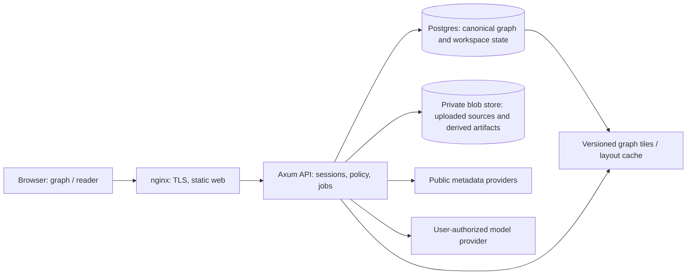
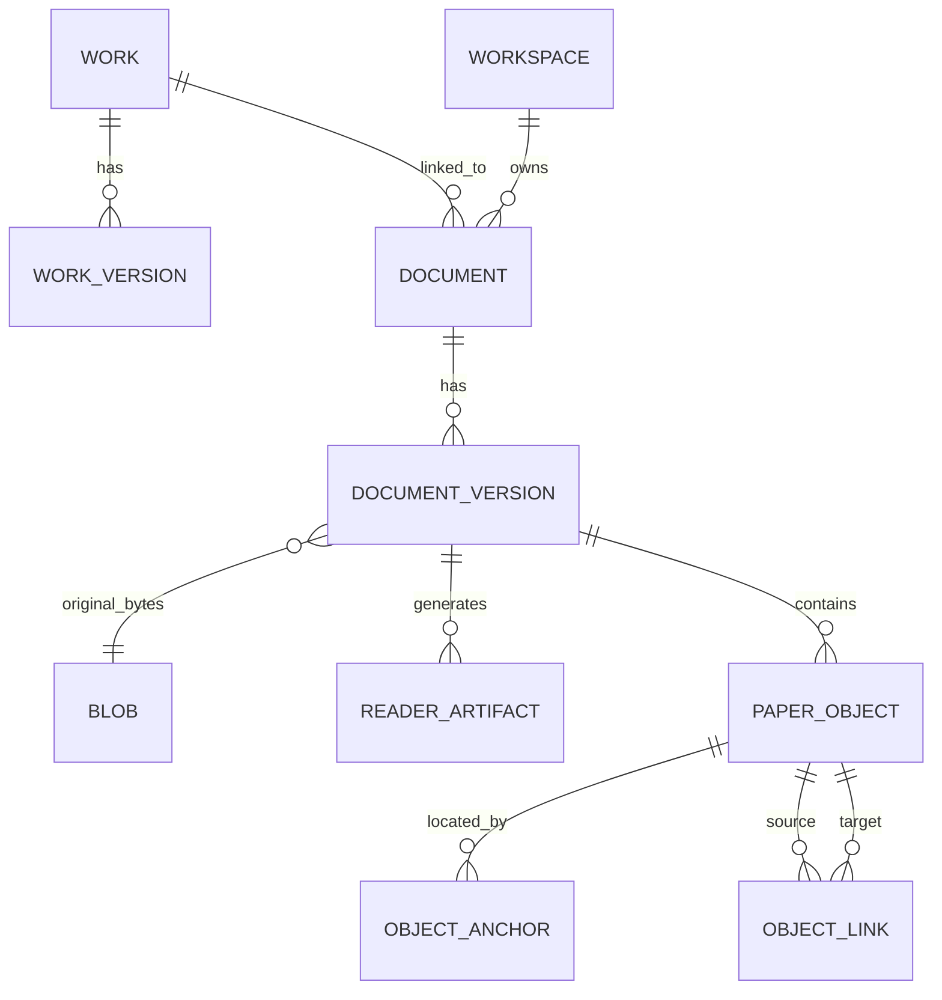

# Postgres knowledge base and hosted reader: refactor plan

Status: proposal, 2026-10-12. This supersedes the SQLite/journal storage design in
`knowledge-base-plan.md` on `integration/knowledge-base`; it does not replace that plan's
paper-object work or evaluation goals. The current `main` branch has a file-backed reader and
per-paper citation-provider snapshots. The SQLite store exists on the integration branch but
has no graph API consumer yet. No production data migration is assumed.

## Product boundary

Lysilogy has two related products on one backend:

1. A **public literature graph** of Works, versions, bibliographic claims, citation evidence,
   and public reading ramps. A Work may exist from a bare reference string. Having a Work record
   does not imply Lysilogy possesses or may serve its full text.
2. A **private reader workspace** containing an account's uploaded PDF/ePUB, notes, highlights,
   generated analysis, reading progress, model credentials, and optionally private ramps. Uploads
   do not become public merely because their metadata links to a public Work.

The first hosted release may be single-operator, but the schema and API must enforce workspace
ownership from the first upload. Publishing a ramp is an explicit copy into a public publication
record with a review of included quotations, links, and source permissions. Public graph records
can point to an external landing page or an authorized open-access copy; the reader only serves
bytes held under the requesting workspace's access grant or a separately approved public asset.

The browser never connects to Postgres. The API authenticates the user and checks the workspace
or publication policy on every read, including source-byte and range requests. Public graph reads
can be anonymous; private artifacts require a session.

## Canonical persistence and identity

Postgres is the source of truth for Work identity, corrections, reviews, lists, ramps, and private
reader metadata. Its WAL is Postgres's own crash-recovery mechanism; there is no Lysilogy
`decisions.jsonl`, hash chain, allocations log, or replay checkpoint. Use versioned SQL migrations
and transactional writes. Back up the database and blob store together, retain WAL for point-in-
time recovery when hosted, and rehearse restores. A logical export of user decisions is useful
for portability but is not required for normal operation.

Use immutable opaque `work.id` values and a `work_redirect` table. Imported observations receive
stable source keys, for example `(provider, provider_record_id, snapshot_revision)` or
`(document_version_id, bibliography_entry_key)`. Re-import is idempotent on those keys. A
rebuild refreshes **derived** search, resolution candidates, and graph caches in a new generation;
it does not drop canonical Works, IDs, reviews, memberships, or source observations. The old G4
wording, which compares IDs after deleting the entire database, must be rewritten: compare two
recomputations from the same canonical database or its restored backup. If a fresh import must
reproduce IDs without a backup, assign deterministic IDs from stable source keys to provisional
Works, then preserve the chosen ID and redirects at resolution. Never derive an accepted Work ID
from mutable title text.

An observation is a claim made by a source, not a fact about a Work. Store source, retrieval time,
source record key, raw payload location/hash, extracted value, and status. Maintain curated or
chosen display fields separately with a pointer to their supporting observation or a user edit.
Use field states `known`, `unknown`, `not_checked`, `conflicting`, and `not_applicable`; SQL NULL
alone is insufficient. Absence of a provider edge means unknown coverage, not an assertion of no
citation. Preserve mistaken reference strings and corrections, including a rejected or disputed
resolution, so a reader can inspect what the citing document actually said.

## Core schema, first cut

Names are illustrative; migrations will specify exact types and constraints. Internal IDs are
UUIDs; short public URL IDs can be encoded from them. Large raw responses and source documents
live in blob storage, referenced by content hash and access scope.

| Table | Key columns and constraints | Purpose |
| --- | --- | --- |
| `work` | `id PK`, `kind`, `created_at`, `visibility`, `display_title`, `title_state`, `display_year`, `year_state` | Bibliographic identity, even when only a reference string exists. No `has_pdf` flag. |
| `work_identifier` | `id PK`, `work_id FK`, `scheme`, `value_normalized`, `source_observation_id FK`, `status`; index `(scheme,value_normalized)` | DOI, arXiv, OpenAlex, etc.; conflicting claims can coexist. Only reviewed active exact identifiers get a partial unique constraint where the scheme warrants it. |
| `work_version` | `id PK`, `work_id FK`, `version_kind`, `version_label`, `date`, `date_state` | Preprint, published edition, and revisions with separate metadata and bibliographies. |
| `source_record` | `id PK`, `kind`, `source_key`, `retrieved_at`, `blob_hash`, `coverage`, `license_info`; unique `(kind,source_key)` | Provider response, publisher record, local extraction, or user assertion, retained with origin and coverage. |
| `field_claim` | `id PK`, `work_id FK`, `version_id FK NULL`, `field`, `value_json`, `state`, `source_record_id FK`, `locator`, `review_state` | Multiple candidate titles, years, authors, etc.; a selected display value points here. |
| `bibliography_entry` | `id PK`, `citing_version_id FK`, `entry_key`, `raw_text`, `page_or_locator`, `source_record_id FK`; unique `(citing_version_id,entry_key)` | Exact item in a known bibliography, including unresolved and incorrect entries. |
| `entry_resolution` | `entry_id FK`, `candidate_work_id FK`, `status`, `method`, `confidence`, `reviewed_by`; unique accepted resolution per entry | Candidate, accepted, rejected, ambiguous, or withdrawn linkage. Resolution changes never erase the entry. |
| `citation_assertion` | `id PK`, `citing_work_id FK`, `cited_work_id FK`, `entry_id FK NULL`, `source_record_id FK`, `status`, `observed_at`; indexes `(citing_work_id,cited_work_id)` and reverse | Evidence that a source says A cites B. A canonical edge view groups accepted assertions; assertions retain independent provenance. |
| `citation_mention` | `id PK`, `assertion_id FK`, `document_version_id FK NULL`, `page_or_locator`, `quote_or_anchor`, `text_hash` | In-text occurrence when the citing source can actually be inspected. Missing is explicit. |
| `relationship_claim` | `id PK`, `assertion_id FK`, `mention_id FK NULL`, `label`, `explanation`, `origin`, `review_state` | “Drew method X from B” is an interpretation supported by a passage, not part of the bare edge. AI proposals do not appear as accepted public labels. |
| `work_redirect` | `old_work_id PK`, `new_work_id FK`, `reason`, `decided_by`, `decided_at` | Stable links after merge; forbid cycles. Split decisions attach specific observations/entries to a new Work. |
| `resolution_decision` | `id PK`, `kind`, `subject_ids`, `actor_id`, `reason`, `created_at` | Auditable merge, split, distinct, and correction decisions. Ordinary relational history, not an event log required for replay. |
| `workspace`, `membership` | workspace/user keys, role | Tenant boundary and authorization. |
| `document`, `document_version` | `id PK`, `workspace_id FK`, `work_id FK NULL`, `blob_id FK`, `format`, `sha256`, `upload_state` | A tenant-held PDF/ePUB; unlinked documents are allowed, as are Works without documents. |
| `blob` | `id PK`, `scope`, `storage_key`, `sha256`, `bytes`, `media_type` | Private or approved-public source and artifact bytes outside Postgres. No public URL derived from storage key. |
| `reading_list`, `list_item`, `ramp`, `ramp_item` | workspace/publication owner, Work FK nullable, unresolved text, ordinal | A list can contain an unresolved item; a published ramp is a reviewed snapshot. |
| `reader_artifact` | document version FK, kind, schema/prompt/model version, blob FK, status | Extraction, geometry, analysis, and notes metadata; notes/highlights use their own workspace-owned tables. |
| `model_connection` | user/workspace FK, provider, encrypted credential reference, scopes, status | Per-user model authorization. No raw token in a graph row, browser URL, or job log. |

`person` and `authorship` follow after the Work/citation slice. Keep printed author strings in
field claims until identity resolution is measured. Text search begins with Postgres full-text
search and `pg_trgm` indexes for candidate retrieval; the matcher still scores and records
decisions. JSONB is for raw variable provider fields, while query-critical keys and relationships
stay typed and indexed. `pgvector` is optional later, not part of the first migration.

## Paper object and byte-storage layer

"Paper object" has three distinct meanings. A `work` is the bibliographic thing one can cite;
`document_version` is a particular PDF/ePUB file held by a workspace; an extracted `paper_object`
is a figure, table, equation, section, theorem, bibliography entry, or other item located inside
one document version. Keep these identities separate: two uploads may be copies of one Work, and
two versions of a Work may have different page numbers, figures, or reference lists.

`document.id` is a stable reader URL identity, even if a file is replaced or renamed.
`document_version.id` is immutable and has format, SHA-256, byte length, upload time, and a blob
reference. `paper_object` has `id`, document-version ID, type, local label, extraction status,
source/artifact revision, and optional curated fields. `object_anchor` is format-specific: PDF
page plus rectangles and exact text span; ePUB spine item plus CFI where available, text quote,
and context hash. Re-extraction may create a new object revision and an explicit old-to-new link;
it cannot silently move an annotation to an approximate location. `object_link` carries typed
relationships such as in-text-mention-to-bibliography-entry, figure-reference-to-figure, and
section-uses-equation. A bibliography entry can then resolve to a Work without requiring that
Work's document. Notes and highlights point to document/object IDs and anchors, not paths.

Postgres offers two binary storage mechanisms: `bytea` (with TOAST for large values) and large
objects. Both are technically usable. Large objects support partial I/O and files beyond the
`bytea` value limit, but make file lifecycle, permissions, database size, WAL volume, and restore
operations part of the database. For a potentially large corpus of PDF/ePUB files and HTTP range
reads, use neither for original publications. Keep small structured object records, anchors,
claims, and state in ordinary Postgres rows; keep large original and generated bytes in a blob
store. This is an architectural choice, not a claim that Postgres cannot hold the bytes.

The blob store is an interface with `put_verified(stream, expected_size/hash)`, `open_range(id)`,
`exists(id)`, and `delete_unreferenced(id)`. Implement two backends:

- **Local managed directory:** opaque, application-generated keys under a configured data root,
  for example `blobs/ab/cd/<sha256>`. The original filename is display metadata only. The API
  never exposes the path or accepts a path from the browser. Use temporary files, checksum
  verification, fsync, and atomic rename; exclude symlinks and traversal.
- **Remote object storage:** a private S3-compatible bucket/keyspace. The same Postgres `blob`
  row refers to it. The app streams or issues short-lived scoped download grants after access
  checks. There is no public bucket for private uploads.

Postgres owns blob metadata and references; the blob store owns bytes. Because they cannot share
one transaction, upload is a small state machine: create an upload intent, stream to a temporary
blob, verify hash/type/size, publish the immutable blob, then commit a ready document version.
Interrupted uploads remain pending and a reconciler removes unreferenced temporary bytes after
a grace period. Deletion first revokes logical access, then collects bytes after reference and
retention checks. A backup manifest of blob IDs and checksums accompanies each database backup;
a restore is accepted only after sampling or verifying referenced blobs. Blob keys can be
content-addressed internally, but deduplication must not reveal whether another workspace has
the same file.

The app process can use local or remote Postgres without changing this schema. Blob placement is
a separate configuration choice:

| App | Postgres | Blob backend | Suitable use |
| --- | --- | --- | --- |
| Local | Local | Managed local directory | Fully local reader. Back up DB and blob root together. |
| Hosted | Remote on `nlessfun` | Private object storage, or durable app-host volume for one server | Initial `lysilogy.com`; object storage is needed before multiple app replicas. |
| Local | Remote | Remote private object storage | Access the same account from multiple devices. |
| Local | Remote | Local directory | Explicitly device-bound documents only; another device sees metadata but cannot open bytes. Do not make this the default synced mode. |

Remote Postgres alone does not synchronize PDF/ePUB bytes. The API's document-availability state
must distinguish missing blob, not authorized, not uploaded, and external link only.

## Joins and access patterns

| User action | Read path | Bound |
| --- | --- | --- |
| Open a Work | `work` → selected `field_claim` → `work_version`/identifiers; resolve redirects first | One Work, paginated versions and claims. |
| Follow a reference | `bibliography_entry` → accepted `entry_resolution` → `work`; show raw entry and unresolved state when no resolution exists | One entry and a small candidate list. |
| See citing/cited Works | Accepted `citation_assertion` grouped by pair, joined to Works; inspect assertions and `source_record` for evidence | Cursor pages; source coverage shown. |
| Inspect an edge label | Pair → assertions → mentions → reviewed `relationship_claim` | Fetch on selection; no large quotes in graph tiles. |
| Open a document | `document` → `blob`, checked against `workspace` membership; optional Work link | Signed/authorized stream and bounded range reads. |
| Pan/zoom graph | Public `graph_tile`/layout generation → bounded nodes and edges; details fetched by ID | Viewport, level of detail, and response budget. |

The interactive map does **not** require memory mapping the whole graph into the browser. At
500k Works and 1–3M edges, the server can keep an adjacency index in Postgres or a versioned
read-only binary snapshot and return bounded neighborhoods or spatial tiles. A browser renders
only visible/selected nodes and edges with WebGL. Stable layout positions and aggregation at low
zoom matter more than `mmap`: labels and evidence arrive on hover or selection. Build a complete
snapshot to a new file/generation, then switch an atomic pointer; never mutate a mapped file in
place. Benchmark server query, tile transfer, browser frame rate, and layout churn separately.

## Source and rights rules

- `work`, identifiers, bibliography entries, and citation assertions are metadata/evidence with
  explicit provenance. “Public graph” is a publication decision for each field/claim; it is not
  a blanket assertion that every provider payload or quotation may be republished.
- `document` is possession and access, separate from Work identity. Private uploads default to
  private, even if their Work is public. No implicit sharing, cross-tenant deduplication visible
  to users, or public PDF fallback from another person's upload.
- A public copy requires a recorded source URL, license/permission basis, check time, and approval.
  A link to a publisher or repository page is distinct from hosting its bytes. ePUB gets the same
  access rules as PDF.
- Public ramps use authored summaries and brief supported excerpts only after a publication
  review. The graph UI shows who made each relationship claim and what evidence is available;
  claims from an index, a citing bibliography, and inspected full text have different badges.
- Before accepting public user uploads or payments, get jurisdiction-specific legal review of
  terms, takedown process, and licenses. The U.S. Copyright Office describes a designated-agent
  requirement for certain hosting safe harbors; treat it as an operational launch gate, not an
  automatic permission to host copyrighted papers.

## Model connection and job boundary

Use one provider-neutral inference interface for local and hosted jobs. Start with OpenRouter's
user OAuth/PKCE flow or a user-provided API key, with explicit consent and per-job cost/limits.
OpenRouter supports issuing a user-controlled key via PKCE. A browser-only request can use that
key directly for simple interactive tasks, but server-side extraction/long jobs need a credential
the server can use; store it encrypted with a revocation path and never mix users' billing. Show
which provider receives a document's text before submission. A user can opt out of all model
processing and still read and navigate the graph.

OpenAI's current “Sign in with ChatGPT” supports identity and, for eligible integrations, separate
consent to use ChatGPT plan capacity for eligible Responses API calls. Its documentation says
remotely hosted or paid apps should use the partner interest process; do not make this the only
launch billing path. OpenAI identity does not grant access to conversations or an API key.
Implement it after confirming eligibility, with a fallback to OpenRouter/user API keys. The
existing local Codex/Claude subprocess adapter remains a local-only option; hosted workers must
not invoke a tenant's desktop CLI or depend on their local session.

## Deployment and local mode

For the first deployment, nginx terminates TLS for `lysilogy.com`, serves the React build, and
proxies `/api` to Axum on a private interface. Postgres may run on `nlessfun` across Tailscale;
allow only the app host to reach it, require TLS/authentication, and keep database ports off the
public internet. This is a practical initial topology, conditional on measured latency and
reliable Tailscale availability. Background ingest and model jobs should use a bounded worker
queue with persisted job states; do not run a long PDF conversion in an HTTP request.

Store uploaded source bytes in a private blob directory on the app host initially, with an
object-store abstraction and independent backup. Record the blob first as pending, then commit
the document row and mark it ready after verifying checksum; garbage-collect orphaned pending
blobs. Backups/restores must cover both Postgres and blobs and be tested together. Postgres
unavailable at startup yields a healthy static reader shell with an explicit graph/account-data
unavailable state and retry; private content operations fail closed. Health endpoints distinguish
process liveness from database readiness.

Local mode uses the same Axum API, schema, and authorization rules with a local Postgres instance
or an explicitly configured connection to the hosted service. `--local` must mean local data and
model calls unless the user connects a remote provider; `--hosted` is a client of lysilogy.com.
Do not make a silent local fallback that writes into the hosted account. A later single-binary
distribution would require a separate storage decision; Postgres is the chosen backend now.

## Execution sequence and acceptance

1. **Freeze the new contract.** Update the knowledge-base plan/status and #33 description to
   record this decision. Close or supersede the SQLite journal implementation work; keep the
   normalizer and provider adapters. Inventory existing artifacts/IDs and decide whether any
   test data deserves import. Acceptance: one canonical schema and migration ownership, with
   issue dependencies reflecting the new order.
2. **Postgres foundation.** Add migrations, connection pool, local test database fixture, app
   startup readiness, backup/restore runbook, and a minimal account/workspace model. CI runs
   migrations and integration tests against disposable Postgres. Acceptance: migrations are
   repeatable; DB outage leaves a usable shell; a restored backup retains user decisions and IDs.
3. **Graph vertical slice.** Ingest a provider snapshot and one paper bibliography as immutable
   source records; create a stub Work from an unresolved entry; resolve it; show its Work page and
   both citation directions with source attribution. Acceptance: raw mistaken strings remain,
   unknown coverage is visible, duplicate ingest is idempotent, and a correction changes the
   selected edge without deleting evidence.
4. **Reader storage and upload.** Add workspace-owned PDF/ePUB upload, validation and conversion
   jobs, private blob streams, and a Work link that is optional. Adapt current file-backed paper
   artifacts behind a storage interface; migrate notes/highlights incrementally. Acceptance:
   tenant isolation tests cover API JSON, blob/range reads, background jobs, and search; a Work
   with no document and a document with no Work both work in the UI.
5. **Model accounts and ramps.** Add OpenRouter connection, provider-neutral jobs, user cost
   limits, private ramp generation, and an explicit public publication flow. Add ChatGPT plan
   integration only when the hosted-app eligibility path is confirmed. Acceptance: revocation,
   failed billing, and no-model mode are clear; no private text appears in public ramps by default.
6. **Graph explorer and scale.** Build versioned layout/tiles, bounded neighborhood endpoints,
   edge-evidence panel, and browser rendering. Measure O28 on 500k Works/3M edges and O29 while
   panning; revise thresholds only with recorded evidence. Acceptance: stable positions across
   incremental updates, bounded hub behavior, inspectable edge labels, and provenance on every
   displayed relationship claim.
7. **Hosted pilot.** Deploy nginx/Axum/Postgres topology, TLS, backup and restore drill,
   monitoring, quotas, and upload/publishing policy. Start with a private pilot and an approved
   public metadata subset. Payments and unrestricted uploads follow the rights/operations review.

The first milestone worth merging is step 3's vertical slice on a disposable Postgres database.
It gives a concrete Work page with an unresolved reference and a sourced citation edge before
moving reader files, models, or public hosting.

## Decisions still to make

1. Is the hosted graph globally curated by the operator, or may users submit public corrections
   subject to review? The first cut assumes operator curation.
2. Do local installations need full offline Postgres, or is a remote hosted account acceptable?
   The first cut supports both explicitly configured modes.
3. Which ramp content can be published under what license and review process? This is required
   before public ramp publication, not before private graph development.
4. Should the first public graph include only open/public-domain source records or all sourced
   bibliographic metadata after provider-specific license review? Start with the smaller reviewed
   subset.

## Documentation checked for this proposal

- [PostgreSQL backup and continuous archiving](https://www.postgresql.org/docs/current/continuous-archiving.html)
- [OpenRouter OAuth PKCE](https://openrouter.ai/docs/guides/overview/auth/oauth)
- [OpenAI Sign in with ChatGPT quickstart](https://developers.openai.com/siwc/quickstart) and
  [hosted-app eligibility note](https://developers.openai.com/siwc/token-sharing-open-source)
- [U.S. Copyright Office designated-agent directory](https://copyright.gov/dmca-directory/)
